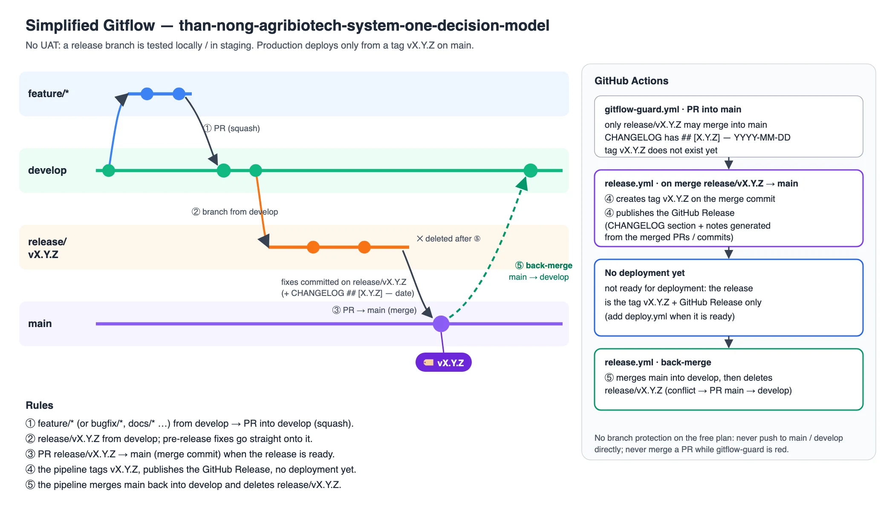

> [!IMPORTANT]
> **Do NOT auto-commit or auto-push unless the developer explicitly asks the bot to do so.**
> The bot must always ask the developer for confirmation before committing and pushing code.

> [!IMPORTANT]
> **The bot prepares a new release only when the developer asks for it.** Merging into `develop` is not a release: no
> `release/vX.Y.Z` branch and no PR into `main` unless the developer explicitly asks for one. Tags and GitHub releases are
> created by the pipeline, never by hand. See [Branches & release flow](#branches--release-flow).

> [!WARNING]
> **This repository is PUBLIC.** Every commit, branch, PR and issue can be read by anyone and stays in git history.
> See [What must never be committed](#what-must-never-be-committed).

# GitHub Commit and Push Rules for Bot

When the bot is asked to commit or push changes to this repository, it must follow these rules in order (step 1 to step 6).
The repo follows the [simplified Gitflow](#branches--release-flow): everyday work goes to **`develop`**, never directly to
`main`.

1. Try to use GitHub MCP tools first to access and operate on the remote GitHub repository.
2. Work in a **git worktree** (or a separate clone), never switch branches in the developer's main checkout. Fetch the latest
   `develop` from the remote. Stop and report to the developer if remote changes conflict with local work in a way the bot
   cannot safely resolve.
3. From `develop`, create a new branch using `feat/*`, `fix/*` or `docs/*`, and commit only on that branch.
4. Create a pull request (PR) to merge the new branch into `develop`.
5. Merge the PR into `develop` (squash). No need to wait for approval from other developers, but stop and report if there are
   conflicts the bot cannot safely resolve.
6. After the merge, delete the feature branch (local and remote), then check the merged `develop` (the docs render, links
   work; once code exists, it builds and its tests pass). That is all: nothing goes to `main` until the developer asks for a
   release.

## Branches & release flow



The diagram source is [`images/gitflow.html`](images/gitflow.html) (open it in a browser to redraw it).

Two primary branches: **`develop`** (integration) and **`main`** (production). There is no UAT environment: a release branch
is checked locally (or in staging), never deployed to a UAT. **No deployment yet** — nothing is published from this repo
today, so a release is the tag `vX.Y.Z` + the GitHub Release (+ the back-merge into `develop`). When the models and the
`/v1/systemone` server are ready to publish, a `deploy.yml` workflow will be added and production will deploy only from the
tags on `main`.

| Branch | What it holds | Gets its changes from |
|---|---|---|
| `develop` | **Integration: daily work.** | PRs from `feat/*`, `fix/*`, `docs/*` (squash) |
| `main` | **Production: released versions only**, each tagged `vX.Y.Z` by the pipeline. The default branch people see. | PR `release/vX.Y.Z` → `main` (merge commit) — **only when the developer asks for a new release** |
| `release/vX.Y.Z` | **One release being prepared**: its CHANGELOG section and the fixes found in the final check. Deleted by the pipeline after the release. | Created from `develop`; fixes are committed directly on it |
| `feat/*`, `fix/*`, `docs/*` | One task each, from `develop`. Deleted after the merge. | — |

Versions are `vX.Y.Z` ([Semantic Versioning](https://semver.org/): a fix → patch, a new feature → minor). The version lives
only in `CHANGELOG.md` and in the tag; the repo has no `pom.xml` / `package.json` to bump.

### 1. Daily work — feature branches into `develop`

```bash
git fetch origin
git worktree add -b docs/<topic> ../wt-<topic> origin/develop
cd ../wt-<topic>
# edit, then stage by path (see below) and commit
git add README.md && git commit -m "docs: <what changed>"
git push -u origin docs/<topic>
gh pr create --base develop --title "docs: <what changed>" --body-file pr.md
gh pr merge <PR> --squash --delete-branch
```

No tag, no release, no PR into `main`.

### 2. Release prep — `release/vX.Y.Z` from `develop` (only when the developer asks)

```bash
git fetch origin
git worktree add -b release/vX.Y.Z ../wt-release origin/develop
cd ../wt-release
# CHANGELOG.md: move the [Unreleased] items into a new "## [X.Y.Z] — YYYY-MM-DD" section (UTC date: date -u +%F),
# leave an empty "## [Unreleased]" above it and update the compare links at the bottom
git add CHANGELOG.md && git commit -m "chore: release vX.Y.Z"
git push -u origin release/vX.Y.Z
```

- Check the release branch locally: the docs render, the links work (once code exists: it builds and its tests pass).
- A fix found during this final check is committed **directly on `release/vX.Y.Z`** and pushed (no PR); it reaches
  `develop` through the back-merge.
- Write the CHANGELOG section in the format of the
  [RAG demo's releases](https://github.com/letrthang/spring-ai-with-hybrid-search-and-system-one-typesafe-jev/releases):
  `### Features` / `### Fixes` / `### Documentation` as they apply; each bullet starts with a **bold lead sentence**, then
  why and how in plain words, and a "Verified: …" note where something was checked. It becomes the GitHub Release text.

### 3. Release — PR `release/vX.Y.Z` → `main`

```bash
gh pr create --base main --head release/vX.Y.Z --title "Release vX.Y.Z" --body-file pr.md
gh pr checks <PR>          # "Gitflow guard" must be green
gh pr merge <PR> --merge   # merge commit, never squash; the pipeline deletes the release branch
```

### 4. What the pipeline does automatically (`.github/workflows/release.yml`)

When the PR `release/vX.Y.Z` → `main` is merged:

1. **Tag** — creates the annotated tag `vX.Y.Z` on the merge commit on `main`.
2. **GitHub Release** — publishes `vX.Y.Z`: the CHANGELOG section followed by the notes GitHub generates from the merged
   PRs/commits.
3. **Back-merge** — merges `main` into `develop` and deletes `release/vX.Y.Z`. On a conflict it opens a PR `main` →
   `develop`, keeps the release branch and the run fails: merge that PR (merge commit), then delete `release/vX.Y.Z`.

No deployment step yet. Nobody tags by hand: never run `git tag` or `gh release create` for a version.

### 5. After the release

```bash
gh release view vX.Y.Z                       # the release exists, with the CHANGELOG section
gh run list --workflow release.yml --limit 1 # the Release run is green (back-merge done)
git fetch origin && git log --oneline -3 origin/develop
```

### Urgent fix (hotfix)

There are no hotfix branches: an urgent fix is a normal small release. Create `release/vX.Y.Z+1` (the next patch version)
from `develop`, commit the fix and its CHANGELOG section on it, then steps 3–5. Never move or reuse a tag; a bad release is
replaced by the next patch release.

### Gitflow guard and the rules

The free GitHub plan has no branch protection, so `.github/workflows/gitflow-guard.yml` marks a PR into `main` red when it
is not from `release/vX.Y.Z`, when `CHANGELOG.md` has no `## [X.Y.Z] — YYYY-MM-DD` section, or when the tag `vX.Y.Z`
already exists.

- **Never push directly to `main` or `develop`**: `develop` gets PRs (squash), `main` gets only the PR from
  `release/vX.Y.Z` (merge commit).
- **Never merge a PR into `main` while "Gitflow guard" is red.**
- Never create, move or delete a tag or a GitHub Release by hand.

## What must never be committed

This repository is public, and git history is permanent: deleting a file later does not un-publish it.

| Never commit | Why |
|---|---|
| tokens, keys, passwords, `.env` / `.env.*`, `.mcp.json` | anyone could use them; a leaked secret must be **rotated**, not just deleted |
| real farm, patient or animal-owner data; real farm / zone / device IDs; names, phone numbers, addresses | personal and business data — use synthetic or anonymised examples |
| data without the right to publish it | training and eval data keep their own licences (see the data card) |
| model weights, checkpoints, large binaries (`*.gguf`, `*.safetensors`, `*.onnx`, datasets) | models live in the Hugging Face model repos, not in git |
| IDE and OS files (`.idea/`, `.DS_Store`), lockfiles or settings changed as a side effect | noise that hides a real change |

## What the Bot May Stage — NEVER `git add -A`

> [!CAUTION]
> **Stage explicit paths. Never `git add -A`, `git add .` or `git add -u`.** Never `git stash`.
> A bot knows which files it edited; a wildcard stages the ones it did not, and those are exactly the files nobody reviews in the
> diff — in a public repo, they are published the moment they are pushed.

```bash
# WRONG — sweeps whatever else the working tree happens to hold
git add -A && git commit -m "..."

# RIGHT — the files this change actually touched
git add README.md architecture.md
git commit -m "..."
```

### Before every commit

1. `git status --short` — read it. Anything you did not edit does not get staged.
2. Stage by path, then `git diff --cached --stat` and confirm the file list is only your change.
3. Read the staged diff for anything from [the list above](#what-must-never-be-committed).
4. If a secret-bearing file is already tracked, untrack it (`git rm --cached <file>`) and tell the developer the secret must be
   rotated.

## Commit messages and PRs

- Commit subject: `<type>: <what changed>` — `feat`, `fix`, `docs`, `chore`, `refactor`, `test`. The body says why, and how it
  was checked.
- PR description: what, why, how it was checked, and what happens after the merge (e.g. "no release").
- Shell: never put backticks or `$(` inside an unquoted heredoc — use `<<'EOF'` or write the text to a file first.

## Issues

All issues for this project go in **this repo**: <https://github.com/letrthang/than-nong-agribiotech-system-one-decision-model/issues>.
Title format `[<type>] <short description>` — `[bug]`, `[feat]`, `[docs]`, `[refactor]`, `[release]`,
`[need-admin-approve]`. Apply a label (`bug`, `enhancement`, `documentation`). Issues are public too: never put a secret or
personal data in one.

## Notes

- Do not commit directly to `develop` or `main`. Feature branches → `develop` by PR (squash); `release/vX.Y.Z` → `main` by
  PR (merge commit) only for a new release.
- Prepare a new release (`release/vX.Y.Z` and its PR into `main`) **only when the developer asks**; the pipeline creates the
  tag and the GitHub release.
- Fetch and rebase before every push.
- Always delete the feature branch after its PR is merged (never `develop` or `main`; the pipeline deletes
  `release/vX.Y.Z`).
- After a merge, pull the branch the PR went into.
